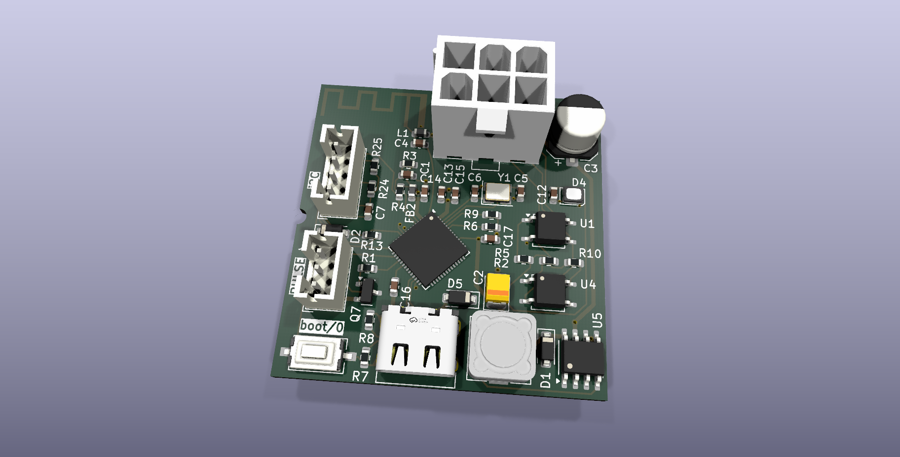
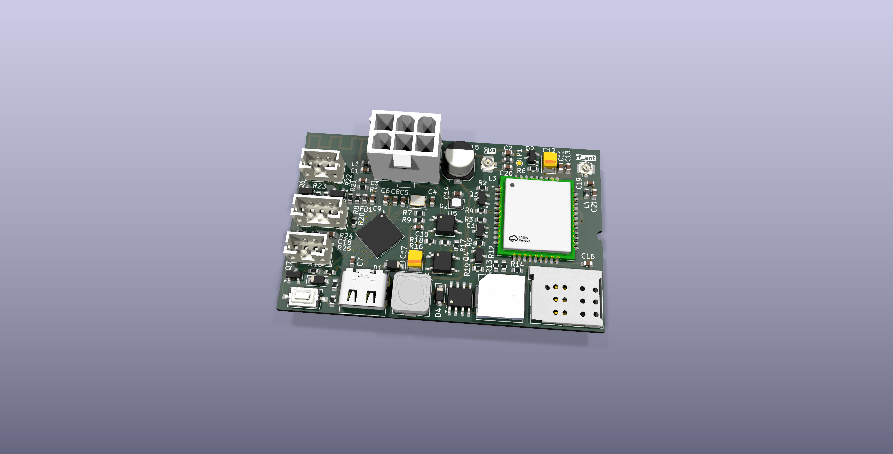
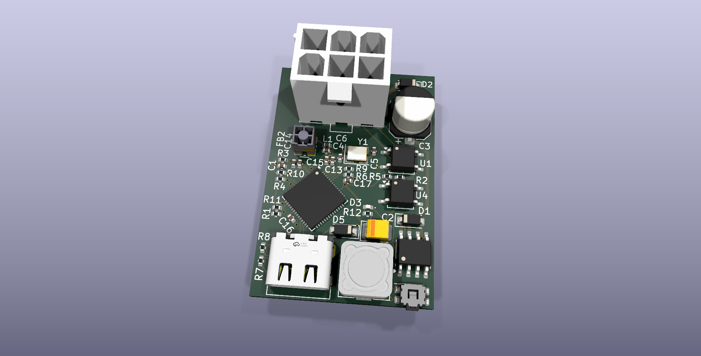
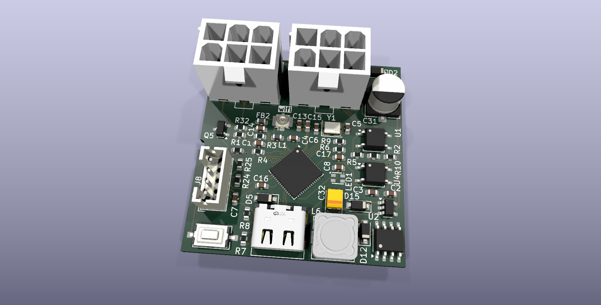
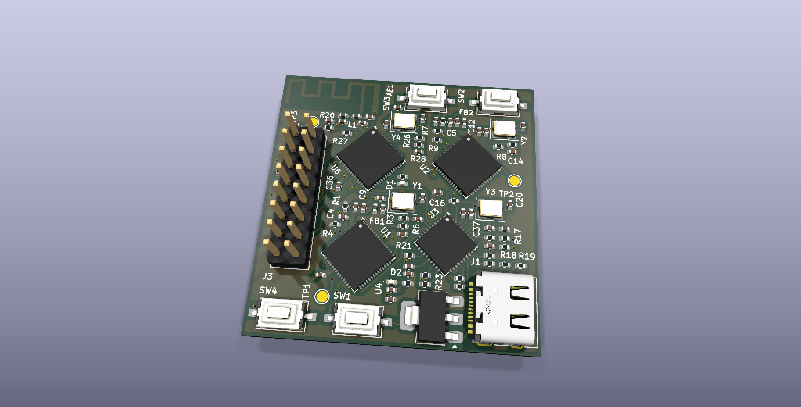

# MDB ESP32 Cashless Devices

This repository contains open hardware projects for MDB-based cashless devices built around the ESP32 platform.

## PCBWay Project Store
You can view and order the PCBs directly from PCBWay using the link below:

👉 https://www.pcbway.com/project/member/?bmbno=1B3B95CB-4E28-4D

---

### MDB ESP32 Cashless Device

[Schematic (PDF)](schematic-mdb-slave-esp32s3.pdf)

### MDB ESP32 GPS/LTE-M/NB-IoT Cashless Device

[Schematic (PDF)](schematic-mdb-slave-esp32s3-sim7080g.pdf)

### MDB ESP32 Cashless Device (Mini, 0402)

[Schematic (PDF)](schematic-mdb-slave-esp32s3-mini.pdf)

### MDB ESP32 Cashless/VMC Device

[Schematic (PDF)](schematic-mdb-bridge-esp32s3.pdf)

### MDB ESP32 AI Bridge (VMflow + VMC + Bill/Coin Reader simulator)
Three ESP32-S3 on one board, each simulating one role of the vending stack — VMflow cashless device, VMC and bill/coin reader — linked by logic-level MDB and reachable through a single USB-C via a USB2514B hub. Bench/CI target for firmware and AI agents without a vending machine.

[Schematic (PDF)](schematic-mdb-ai-bridge-esp32s3.pdf)
