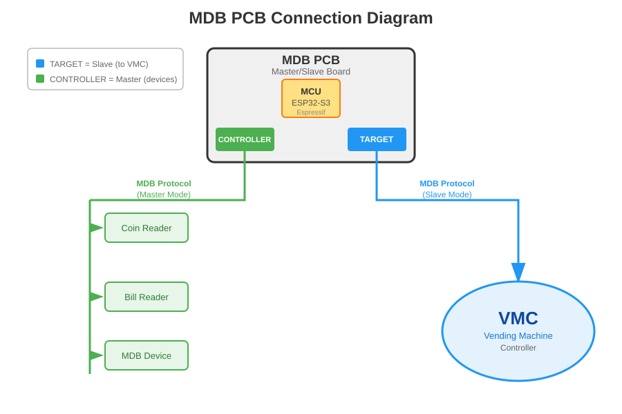
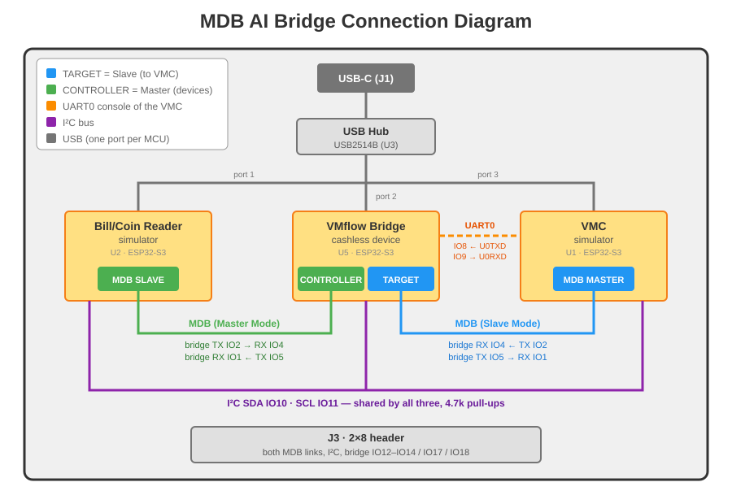

# MDB ESP32 Cashless Devices

This repository contains open hardware projects for MDB-based cashless devices built around the ESP32 platform.

## PCBWay Project Store
You can view and order the PCBs directly from PCBWay using the link below:

👉 https://www.pcbway.com/project/member/?bmbno=1B3B95CB-4E28-4D

---

### MDB ESP32 Cashless Device

[Schematic (PDF)](schematic-mdb-slave-esp32s3.pdf)

### MDB ESP32 GPS/LTE-M/NB-IoT Cashless Device

[Schematic (PDF)](schematic-mdb-slave-esp32s3-sim7080g.pdf)

### MDB ESP32 Cashless Device (Mini, 0402)

[Schematic (PDF)](schematic-mdb-slave-esp32s3-mini.pdf)

### MDB ESP32 Cashless/VMC Device

[Schematic (PDF)](schematic-mdb-bridge-esp32s3.pdf)

Two independent MDB ports: the board is the master on the **controller** port (peripherals: coin changer, bill validator) and a slave on the **target** port (the vending machine's VMC).

| Port           | RX  | TX  | Board role         | Connects to                               |
|----------------|-----|-----|--------------------|-------------------------------------------|
| **Controller** | IO1 | IO2 | master (VMC)       | peripherals: coin changer, bill validator |
| **Target**     | IO4 | IO5 | slave (peripheral) | the vending machine's VMC/master          |

### MDB ESP32 AI Bridge (VMflow + VMC + Bill/Coin Reader simulator)
Three ESP32-S3 on one board, each simulating one role of the vending stack — VMflow cashless device, VMC and bill/coin reader — linked by logic-level MDB and reachable through a single USB-C via a USB2514B hub. Bench/CI target for firmware and AI agents without a vending machine.

[Schematic (PDF)](schematic-mdb-ai-bridge-esp32s3.pdf)

The bridge MCU keeps the pinout of the MDB ESP32 Cashless/VMC Device, so the same firmware runs on both boards; the two simulators sit on its ports in place of the real peripherals and VMC.

| MCU    | Role                               | MDB RX | MDB TX | USB hub port |
|--------|------------------------------------|--------|--------|--------------|
| **U5** | VMflow bridge, controller port     | IO1    | IO2    | 2            |
| **U5** | VMflow bridge, target port         | IO4    | IO5    | 2            |
| **U2** | bill/coin reader simulator (slave) | IO4    | IO5    | 1            |
| **U1** | VMC simulator (master)             | IO1    | IO2    | 3            |

The bridge also reaches the VMC simulator's UART0 console (bridge IO8 ← U0TXD, IO9 → U0RXD). I²C (SDA IO10, SCL IO11) is shared by all three, with 4.7k pull-ups. The J3 2×8 header exposes both MDB links, the I²C bus and bridge IO12–IO14, IO17 and IO18.

